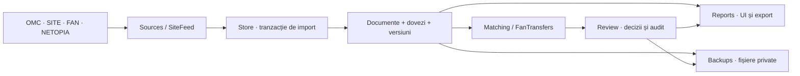

# Arhitectură și model de date

- **Intrare HTTP** — `app/index.php`, `api.php` și `setup.php` încarcă implementarea din `app/public/`. Apache servește doar intrările și activele permise de `.htaccess`. `router.php` deservește testarea cu serverul local PHP.
- **Import** — `Sources` citește CSV și XLSX. `Store` salvează documentele, istoricul, hashurile și referințele către fișiere. Importul folosește o tranzacție și un lock MariaDB pe baza aplicației. Un fișier identic recunoscut după SHA-256 nu produce o nouă aplicare.
- **Asociere și decizii** — `Matching` propune și aplică perechi eligibile prin `Review`. `FanTransfers` validează dovezile financiare după AWB. `Operations` gestionează corecții și cazuri operaționale. `Topups`, `Allocations` și `ReturnReview` completează situațiile financiare.
- **Citire** — `Reports` proiectează datele sursă și deciziile în Raport, Comenzi, NETOPIA și Retururi. `public/assets/app.js` gestionează navigarea, filtrele, paginarea și dialogurile. Temele Warm Gold, Mineral Blue și Sage Green sunt definite în `themes.css`.
- **Operare tehnică** — `Core` configurează PDO, sesiunea, rolurile și auditul. `Deployment`, `Migration` și `Backups` instalează, restaurează și verifică datele. În SQL, drepturile uzuale sunt DML pe baza dedicată.

## Modelul de date

| Date | Tabele principale |
| --- | --- |
| Originale de import și revizii | `import_files`, `import_rows`, `source_versions` |
| Facturi, comenzi, expedieri și plăți | `invoices`, `site_orders`, `fan_shipments`, `netopia_payments`, `payment_identifiers` |
| Dovezi auxiliare | `provider_adjustments`, inclusiv probe financiare FAN și ajustări NETOPIA |
| Legături între documente | `invoice_orders`, `shipment_assignments`, `payment_resolutions` |
| Decizii și istoric | `decisions`, `audit_events`, `review_batches`, `review_items`, `migration_map` |
| Livrări și retururi | `gpd_drivers`, `gpd_deliveries`, `shipment_returns`, `refunds`, `cash_circuits` |
| Conturi și configurări din aplicație | `users`, `application_settings`, `invoice_preferences` |

Schema SQL este contractul pentru chei, tipuri și relații. O asociere confirmată are o decizie cu autor, motiv și dovezi. O înregistrare poate avea mai multe versiuni de sursă. Solicitările de decizie pot include hashurile versiunilor verificate, astfel încât o decizie veche să nu se aplice după schimbarea sursei.

## API intern

`api.php?action=...` răspunde cu JSON, cu excepția descărcărilor. GET oferă, între altele, `state`, `report`, `orders`, `netopia`, `returns`, `invoice`, `history`, `imports`, `fan_transfer_cases` și `export`. POST folosește sesiunea și tokenul CSRF. Exemple sunt `import_files` multipart, `fetch_site`, `save`, `stage`, `fan_transfer_date` și `backup_create`. Lista și parametrii efectivi sunt în `app/public/api.php`. Rutele vechi de previzualizare a importului există pentru compatibilitate. Interfața per sursă folosește importul direct.
